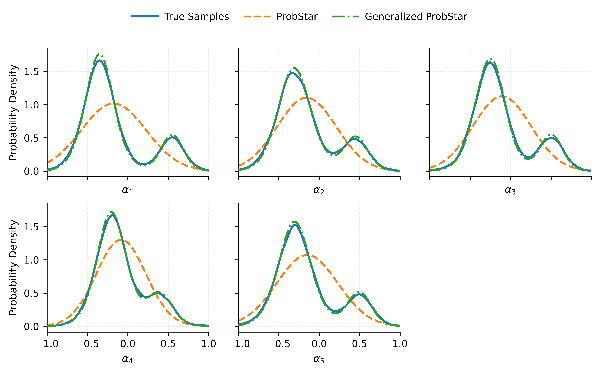
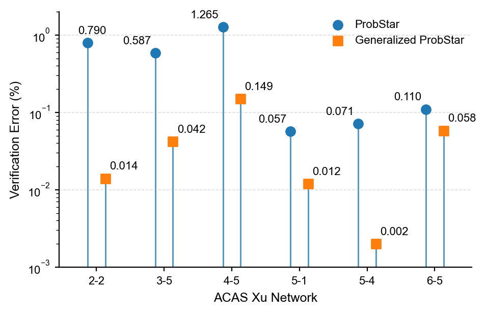

# Generalized ProbStar: Distribution-Aware Probabilistic Verification

This repository contains the experimental code for our work on
**Generalized ProbStar (GPS)**, a distribution-aware extension of
ProbStar for probabilistic neural-network verification under
non-Gaussian and multimodal input uncertainty.

## Experimental Configuration

The following configuration was recorded on the workstation used to prepare and test the artifact. It should not be interpreted as the hardware used for every result reported in the paper unless independently confirmed.

| Component | Configuration |
|---|---|
| CPU | Intel Core Ultra 9 275HX (24 physical cores, 24 logical CPUs; up to 5.4 GHz) |
| Memory | 64 GB nominal RAM (62 GiB reported by Linux); 8 GiB swap |
| Architecture | x86_64 |
| Operating system | Ubuntu 24.04.2 LTS |
| Python | 3.13.12 |
| NumPy | 2.5.2 |
| SciPy | 1.18.1 |
| scikit-learn | 1.9.1 |
| Matplotlib | 3.11.2 |
| psutil | 7.2.2 (installed in the recorded environment) |

Install the Python dependencies from the repository root:

```bash
python3 -m pip install -r requirements.txt
```

The pinned package versions reproduce the recorded software configuration. A clean-environment installation and end-to-end verification run have not yet been documented. Hardware and software differences may affect runtime, memory use, and floating-point results.

The experiments use the **ACAS Xu** benchmark and compare three
predicate-distribution models:

-   **True distribution:** a truncated two-component 5D Student-(t)
    mixture on (\[-1,1\]\^5).
-   **ProbStar (PS):** a single truncated 5D Gaussian approximation.
-   **Generalized ProbStar (GPS):** a truncated 10-component Gaussian
    mixture model (GMM) fitted using expectation-maximization (EM).

The experimental pipeline separates exact reachability from probability
computation:

``` text
ACAS Xu network
      |
      v
Exact-Star propagation
      |
      v
Saved reachable Stars
      |
      v
Unsafe-region intersection
      |
      +------------------+------------------+
      |                  |                  |
      v                  v                  v
 True distribution    ProbStar          Generalized
 Student-t mixture    Gaussian           ProbStar GMM
      |                  |                  |
      +------------------+------------------+
                         |
                         v
        Unsafe probability / error / runtime / memory
```

## Estimated Runtime and Memory Requirements

The following estimates help artifact evaluators plan their runs. Runtime estimates are based on the reported verification experiments and the authors' approximate timing of the separate probability-computation stage; they are **not independent wall-clock measurements of each script**. P2 memory is referenced to reported verification results. The ~1.5 GB figures for the complete P3/P4 network sweeps are author-provided planning estimates, not measured full-sweep peaks or strict upper bounds.

| Script | Networks | Estimated Runtime | Estimated Memory |
|---|---:|---:|---:|
| `em_algorithm.py` | — | ~1 minute | ~5 MB |
| `distribution_mismatch.py` | — | ~30 seconds | <100 MB |
| `accuracy_result.py` | — | ~30 seconds | <100 MB |
| `P2_propagation.py` | 6 | ~283 hours | ~21 GB |
| `P2_unsafe_compute.py` | 6 | ~2 hours | <1 GB |
| `P2_full_pipeline.py` | 6 | ~285 hours | ~21 GB |
| `P3_propagation.py` | 45 | ~17 hours | ~1.5 GB |
| `P3_unsafe_compute.py` | 45 | ~30 minutes | <500 MB |
| `P3_full_pipeline.py` | 45 | ~17.5 hours | ~1.5 GB |
| `P4_propagation.py` | 9 | ~1 hours | ~0.2 GB |
| `P4_unsafe_compute.py` | 9 | ~30 minutes | <100 MB |
| `P4_full_pipeline.py` | 9 | ~1.5 hours | ~0.3 GB |

**Scope of the reported results.** The paper's selected P3 networks account for approximately **6.39 hours** in total, and its six selected P4 networks account for approximately **1 hour**. The approximately **17.5-hour** figure for P3 refers to the full set of 45 networks. The same figure for P4 is a projection **conditional on running the same 45 networks**: both properties use Exact-Star propagation, which dominates the computational cost. The P4 scripts documented in this repository were previously configured for networks **1-4 through 1-9**; a 45-network P4 run requires confirming or changing that selection. Do not interpret the projected 45-network P4 runtime as a measurement of the current six-network script.

**Interpreting memory values.** The `<100 MB`, `<500 MB`, and `<1 GB` entries are provisional estimates rather than independently measured process-memory limits. In particular, loading saved reachable Stars may exceed these estimates.  The P2 reference of ~21.1 GB is the largest reported GPS memory measurement (network 4-5: 21,070.76 MB). The paper reports ~1.13 GB as the largest memory value among its selected P3 networks and ~0.18 GB among its six selected, relatively small P4 networks. These selected-network maxima are not representative of the complete 45-network P4 sweep. For planning purposes, the authors estimate **~1.5 GB** for the complete P3 and P4 propagation and full-pipeline runs; this is **not a measured peak or guaranteed upper bound**. Propagation creates most of the reachable-set data, so it dominates the resource requirements. However, the two-stage probability scripts reload saved Stars, and the full pipelines retain Stars in memory; their actual process-level peak memory may therefore differ from the reported values. Low overhead for distribution fitting or probability integration should not be interpreted as zero RAM usage.

Times and memory use depend on the machine, numerical libraries, solver configuration, and concurrent workload. Runs are assumed to execute networks sequentially when totals are given.

## Repository Structure

### Distribution modeling

  -----------------------------------------------------------------------
  File                                Description
  ----------------------------------- -----------------------------------
  `em_algorithm.py`                   Generates samples from the true
                                      truncated Student-(t) mixture, fits
                                      the single-Gaussian ProbStar
                                      approximation and the 10-component
                                      GMM used by Generalized ProbStar,
                                      and evaluates distribution
                                      mismatch.

  `distribution_mismatch.py`          Produces the marginal-distribution
                                      comparison used to visualize the
                                      mismatch between the true
                                      distribution, ProbStar, and
                                      Generalized ProbStar.

  `distribution_marginals_3x2.png`    Marginal-density comparison for the
                                      five predicate variables.

  `accuracy_result.py`                Generates the verification-error
                                      comparison figure for the selected
                                      Property-2 networks.

  `accuracy.png`                      Comparison of the absolute
                                      unsafe-probability errors of
                                      ProbStar and Generalized ProbStar.
  -----------------------------------------------------------------------

### ACAS Xu reachability

  -----------------------------------------------------------------------
  File                                Description
  ----------------------------------- -----------------------------------
  `P2_propagation.py`                 Exact-Star propagation for the six
                                      selected ACAS Xu Property-2
                                      networks.

  `P3_propagation.py`                 Exact-Star propagation for the
                                      Property-3 ACAS Xu experiments.

  `P4_propagation.py`                 Exact-Star propagation for the
                                      Property-4 ACAS Xu experiments.

  `ACASXU/`                           ACAS Xu neural-network benchmark
                                      files used by the propagation
                                      scripts.
  -----------------------------------------------------------------------

The propagation stage is purely geometric. It propagates exact Stars
through the affine and ReLU layers and saves the resulting reachable
Stars. No probability distribution is required during this stage.

### Unsafe-probability computation

  -----------------------------------------------------------------------
  File                                Description
  ----------------------------------- -----------------------------------
  `P2_unsafe_compute.py`              Computes unsafe probabilities for
                                      the six selected Property-2
                                      networks using the true, PS, and
                                      GPS predicate distributions.

  `P3_unsafe_compute.py`              Computes Property-3 unsafe
                                      probabilities from saved exact
                                      reachable Stars.

  `P4_unsafe_compute.py`              Computes Property-4 unsafe
                                      probabilities from saved exact
                                      reachable Stars.
  -----------------------------------------------------------------------

These scripts do **not** repeat network propagation. They load the saved
reachable Stars, intersect them with the corresponding unsafe output
region, and evaluate the probability under each of the three fixed
predicate distributions.

### Full pipelines (recommended for direct reproduction)

| File | Description |
|---|---|
| `P2_full_pipeline.py` | Runs Property 2 reachability and unsafe-probability evaluation in one process. |
| `P3_full_pipeline.py` | Runs Property 3 reachability and unsafe-probability evaluation in one process. |
| `P4_full_pipeline.py` | Runs Property 4 reachability and unsafe-probability evaluation in one process. |

**Purpose of the full pipelines.** The three full pipeline scripts provide a direct way to reproduce the verification experiments for ACAS Xu Properties 2, 3, and 4. Each script performs Exact-Star propagation, unsafe-region intersection, and unsafe-probability computation in a single execution. `P2_full_pipeline.py` reproduces the six selected nontrivial probability and verification-error comparisons; `P3_full_pipeline.py` evaluates Property 3; and `P4_full_pipeline.py` evaluates Property 4. The latter two properties primarily demonstrate the reported 0% and 100% outcomes for their selected cases.

Unlike the two-stage workflow, the full pipelines pass reachable Stars directly between propagation and probability computation in memory, avoiding intermediate Star pickle files. They use the **same verification algorithms** as the corresponding two-stage scripts; the goal is simpler end-to-end reproduction, not a different verification method or reduced Exact-Star propagation cost.

**When to use the two-stage scripts.** If the same reachable sets need to be evaluated under different predicate distributions or probability settings, run the propagation script once and reuse the saved Stars with the corresponding `P*_unsafe_compute.py` script. This avoids repeating the expensive reachability computation. The two-stage workflow may require substantial disk space and memory when saved Stars are reloaded.

The reported experiment selections are six Property-2 networks, all 45 Property-3 networks in the extended code, and Property-4 networks 1-4 through 1-9 (network IDs 4–9). The results table below displays selected Property-3 cases rather than all 45 networks.

## Distribution Approximation Experiment

The ground-truth uncertainty model is a truncated two-component 5D
Student-(t) mixture. The main Generalized ProbStar approximation uses a
**10-component GMM** fitted by EM.

For the reported fitting run:

  Quantity                                          Result
  ------------------------------------------ -------------
  Number of samples                                 10,000
  GMM components                                        10
  EM converged                                         Yes
  EM iterations                                        875
  ProbStar fitting time                         0.000340 s
  ProbStar peak fitting memory                 0.445190 MB
  Generalized ProbStar fitting time            53.280812 s
  Generalized ProbStar peak fitting memory     5.187165 MB
  Reported statistical-test (p)-value           **0.0006**

The distribution experiment shows that a single Gaussian does not
capture the multimodal structure of the true input distribution well,
whereas the GMM provides a substantially closer approximation.

### Fitted GMM Parameters Used for Verification

The following are the **fixed 10-component Gaussian mixture parameters embedded in `P2_unsafe_compute.py`** for the GPS probability evaluation. Each component contains a mixture weight, a five-dimensional mean vector, and a 5 × 5 covariance matrix. The weights are normalized by their sum in the verification script. The truncated-mixture normalization constant in that script is `Z_GMM = 0.9813868733`.

**Reproducibility note:** These values are transcribed from the verification code, not from a newly executed EM fitting run. `em_algorithm.py` may produce different fitted parameters depending on its sample count, random seed, and fitting settings. For exact reproduction of the reported verification results, use the fixed parameters in the verification scripts.

**Component 1** — weight: `0.28300800`; mean: `[-0.34558652, -0.30412842, -0.24923874, -0.18281973, -0.31633116]`

Covariance:

```text
[ 0.01979855, 0.00006393, 0.00051066, 0.00281928, -0.00221216 ]
[ 0.00006393, 0.02955551, 0.00018640, 0.00017041, 0.00350867 ]
[ 0.00051066, 0.00018640, 0.02563112, -0.00017909, -0.00006009 ]
[ 0.00281928, 0.00017041, -0.00017909, 0.02607916, 0.00314249 ]
[ -0.00221216, 0.00350867, -0.00006009, 0.00314249, 0.02251244 ]
```

**Component 2** — weight: `0.24510673`; mean: `[-0.38146254, -0.27427800, -0.29571725, -0.19167988, -0.38197128]`

Covariance:

```text
[ 0.04293289, -0.00021238, -0.00343148, -0.00258473, -0.00266919 ]
[ -0.00021238, 0.05128917, 0.00186295, 0.00038233, -0.00063810 ]
[ -0.00343148, 0.00186295, 0.03602537, 0.00602461, -0.00067230 ]
[ -0.00258473, 0.00038233, 0.00602461, 0.03924504, -0.00208983 ]
[ -0.00266919, -0.00063810, -0.00067230, -0.00208983, 0.04701325 ]
```

**Component 3** — weight: `0.13520286`; mean: `[0.55150431, 0.45262660, 0.50743149, 0.39660933, 0.50053115]`

Covariance:

```text
[ 0.01627100, -0.00069143, -0.00140774, 0.00128459, 0.00063360 ]
[ -0.00069143, 0.01873681, 0.00013508, 0.00072080, 0.00024266 ]
[ -0.00140774, 0.00013508, 0.01655289, 0.00061736, 0.00003026 ]
[ 0.00128459, 0.00072080, 0.00061736, 0.02110142, -0.00142189 ]
[ 0.00063360, 0.00024266, 0.00003026, -0.00142189, 0.01854472 ]
```

**Component 4** — weight: `0.12050350`; mean: `[-0.37757650, -0.30791713, -0.24383230, -0.22040672, -0.19467421]`

Covariance:

```text
[ 0.04149231, 0.00408128, 0.00486950, 0.00299395, 0.01552095 ]
[ 0.00408128, 0.06293590, 0.00291951, -0.00766230, 0.00062837 ]
[ 0.00486950, 0.00291951, 0.06160253, -0.00969989, -0.00795539 ]
[ 0.00299395, -0.00766230, -0.00969989, 0.05647876, 0.00201741 ]
[ 0.01552095, 0.00062837, -0.00795539, 0.00201741, 0.05774970 ]
```

**Component 5** — weight: `0.07273553`; mean: `[-0.27915168, -0.37077062, -0.19831213, -0.25004395, -0.14851801]`

Covariance:

```text
[ 0.04141458, 0.00206272, -0.00474192, -0.00148020, -0.01179525 ]
[ 0.00206272, 0.03177307, 0.00060621, 0.00590184, 0.00156027 ]
[ -0.00474192, 0.00060621, 0.02453604, -0.00102905, -0.00423807 ]
[ -0.00148020, 0.00590184, -0.00102905, 0.01563799, 0.00529446 ]
[ -0.01179525, 0.00156027, -0.00423807, 0.00529446, 0.02212083 ]
```

**Component 6** — weight: `0.05958471`; mean: `[0.52965069, 0.45055315, 0.48575273, 0.39383445, 0.46604986]`

Covariance:

```text
[ 0.03717413, 0.00118489, 0.00148188, 0.00086129, -0.00360670 ]
[ 0.00118489, 0.04248193, -0.00308997, -0.00320486, -0.00271715 ]
[ 0.00148188, -0.00308997, 0.03842504, -0.00042302, 0.00376254 ]
[ 0.00086129, -0.00320486, -0.00042302, 0.05174106, 0.00240626 ]
[ -0.00360670, -0.00271715, 0.00376254, 0.00240626, 0.04364519 ]
```

**Component 7** — weight: `0.04617820`; mean: `[-0.25525745, -0.25305826, -0.19763299, -0.12080802, -0.21604355]`

Covariance:

```text
[ 0.09571889, 0.00974677, -0.00713545, -0.00477402, -0.02887704 ]
[ 0.00974677, 0.11369134, 0.00645309, 0.00699384, 0.00097629 ]
[ -0.00713545, 0.00645309, 0.11896911, 0.00231065, 0.01613714 ]
[ -0.00477402, 0.00699384, 0.00231065, 0.10154114, -0.01797944 ]
[ -0.02887704, 0.00097629, 0.01613714, -0.01797944, 0.09686887 ]
```

**Component 8** — weight: `0.01680844`; mean: `[-0.37078501, -0.30628064, -0.16261368, -0.20351010, -0.52456275]`

Covariance:

```text
[ 0.04616753, -0.02088663, 0.03603102, 0.00185709, 0.01949255 ]
[ -0.02088663, 0.09382258, -0.05226160, -0.04154559, 0.00634369 ]
[ 0.03603102, -0.05226160, 0.08609198, 0.00894669, -0.01575531 ]
[ 0.00185709, -0.04154559, 0.00894669, 0.07446758, 0.00915059 ]
[ 0.01949255, 0.00634369, -0.01575531, 0.00915059, 0.03745857 ]
```

**Component 9** — weight: `0.01403072`; mean: `[-0.27908779, -0.35899413, -0.14668842, -0.39081333, -0.18644871]`

Covariance:

```text
[ 0.04010451, -0.01878237, -0.00328250, 0.01420448, -0.00606186 ]
[ -0.01878237, 0.01956414, 0.00408125, 0.00346255, 0.00823425 ]
[ -0.00328250, 0.00408125, 0.01207111, 0.00449625, 0.02315015 ]
[ 0.01420448, 0.00346255, 0.00449625, 0.03723127, 0.00724532 ]
[ -0.00606186, 0.00823425, 0.02315015, 0.00724532, 0.04830860 ]
```

**Component 10** — weight: `0.00684131`; mean: `[-0.13295655, -0.56761481, -0.33667030, -0.23337530, -0.45320787]`

Covariance:

```text
[ 0.02981105, -0.00005920, 0.02488262, 0.03946179, 0.00791451 ]
[ -0.00005920, 0.03922133, 0.02172393, 0.00435795, -0.02542279 ]
[ 0.02488262, 0.02172393, 0.08562576, 0.02852525, -0.02189836 ]
[ 0.03946179, 0.00435795, 0.02852525, 0.06464091, 0.02990876 ]
[ 0.00791451, -0.02542279, -0.02189836, 0.02990876, 0.06970784 ]
```

## Distribution Marginals

The following figure compares the one-dimensional marginal distributions
of the true Student-(t) mixture, the single-Gaussian ProbStar
approximation, and the GMM-based Generalized ProbStar approximation.



The figure is intended as a visual comparison of the five
one-dimensional marginals. The verification experiment itself is
performed in the full five-dimensional predicate space.


## ACAS Xu Verification Results

We evaluate ProbStar (PS) and Generalized ProbStar (GPS) on ACAS Xu Properties 2, 3, and 4. We report the number of final reachable Stars, total runtime, memory usage, unsafe probabilities, and absolute verification errors.

The absolute unsafe-probability error is defined as

$$
e_{\mathrm{ver}} = \left|p - p_{\mathrm{true}}\right|,
$$

where $p_{\mathrm{true}}$ is the unsafe probability evaluated under the true truncated Student-t mixture.

### Reachability, Runtime, and Memory

The following table reports the final reachable-Star counts, total runtime, and memory usage for PS and GPS.

| Property | Network | # Stars | PS Time (s) | GPS Time (s) | PS Memory (MB) | GPS Memory (MB) |
|:---:|:---:|---:|---:|---:|---:|---:|
| P2 | 2-2 | 472,257 | 1.640e5 | 1.641e5 | 9739.40 | 9786.32 |
| P2 | 3-5 | 252,793 | 5.764e4 | 5.769e4 | 4605.07 | 4651.99 |
| P2 | 4-5 | 1,003,886 | 2.880e5 | 2.881e5 | 21023.84 | 21070.76 |
| P2 | 5-1 | 475,299 | 1.671e5 | 1.672e5 | 10198.36 | 10245.28 |
| P2 | 5-4 | 402,853 | 1.301e5 | 1.301e5 | 8191.54 | 8238.46 |
| P2 | 6-5 | 652,417 | 2.193e5 | 2.193e5 | 13580.24 | 13627.16 |
| P3 | 1-1 | 70,631 | 8098.693 | 8151.974 | 1123.77 | 1128.51 |
| P3 | 1-2 | 39,529 | 8533.474 | 8586.755 | 686.03 | 690.77 |
| P3 | 4-3 | 20,746 | 4748.192 | 4801.473 | 397.38 | 402.12 |
| P3 | 3-6 | 1,857 | 759.773 | 813.054 | 39.49 | 44.23 |
| P3 | 1-7 | 500 | 208.800 | 262.089 | 62.39 | 67.43 |
| P3 | 1-8 | 393 | 172.555 | 225.895 | 64.82 | 69.56 |
| P3 | 1-9 | 290 | 111.301 | 164.443 | 58.42 | 63.16 |
| P4 | 1-4 | 1,184 | 285.757 | 338.026 | 21.83 | 67.43 |
| P4 | 1-5 | 6,608 | 1819.437 | 1869.768 | 133.67 | 181.42 |
| P4 | 1-6 | 4,443 | 853.274 | 908.955 | 79.15 | 124.27 |
| P4 | 1-7 | 642 | 128.514 | 185.715 | 11.34 | 61.26 |
| P4 | 1-8 | 397 | 166.478 | 213.729 | 7.51 | 51.43 |
| P4 | 1-9 | 471 | 124.378 | 179.259 | 8.43 | 57.15 |

### Unsafe Probabilities and Verification Errors

The following table compares the unsafe probabilities computed using PS, GPS, and the true input distribution. Verification errors are absolute differences from the true unsafe probability, reported in percentage points.

| Property | Network | PS Probability | GPS Probability | True Probability | PS Error | GPS Error |
|:---:|:---:|---:|---:|---:|---:|---:|
| P2 | 2-2 | 2.655% | 3.458% | 3.445% | 0.790% | 0.014% |
| P2 | 3-5 | 3.060% | 2.431% | 2.473% | 0.587% | 0.042% |
| P2 | 4-5 | 2.291% | 3.704% | 3.555% | 1.265% | 0.149% |
| P2 | 5-1 | 0.297% | 0.228% | 0.240% | 0.057% | 0.012% |
| P2 | 5-4 | 0.101% | 0.028% | 0.030% | 0.071% | 0.002% |
| P2 | 6-5 | 2.837% | 2.889% | 2.947% | 0.110% | 0.058% |
| P3 | 1-1 | 0% | 0% | 0% | 0% | 0% |
| P3 | 1-2 | 0% | 0% | 0% | 0% | 0% |
| P3 | 4-3 | 0% | 0% | 0% | 0% | 0% |
| P3 | 3-6 | 0% | 0% | 0% | 0% | 0% |
| P3 | 1-7 | 100% | 100% | 100% | 0% | 0% |
| P3 | 1-8 | 100% | 100% | 100% | 0% | 0% |
| P3 | 1-9 | 100% | 100% | 100% | 0% | 0% |
| P4 | 1-4 | 0% | 0% | 0% | 0% | 0% |
| P4 | 1-5 | 0% | 0% | 0% | 0% | 0% |
| P4 | 1-6 | 0% | 0% | 0% | 0% | 0% |
| P4 | 1-7 | 100% | 100% | 100% | 0% | 0% |
| P4 | 1-8 | 100% | 100% | 100% | 0% | 0% |
| P4 | 1-9 | 100% | 100% | 100% | 0% | 0% |

### Accuracy on the nontrivial Property-2 cases

For all six selected P2 networks, Generalized ProbStar gives a smaller
absolute unsafe-probability error than the original single-Gaussian
ProbStar model.



The largest reduction occurs for network 4-5, where the absolute error
decreases from **1.265%** to **0.149%**. For network 2-2, the error
decreases from **0.790%** to **0.014%**. The remaining selected networks
show the same trend.

For P3 and P4, the reported cases have unsafe probabilities of either 0%
or 100% under all three distributions. These cases therefore confirm the
same qualitative verification result across the tested uncertainty
models, but they are not used to quantify the distribution-modeling
accuracy improvement.

## Scalability

The reachability geometry is identical for PS and GPS. The difference
appears in distribution fitting and probability evaluation.

For large reachability problems, exact ReLU reachability dominates the
total runtime and memory cost. This is visible in the large P2 cases.
For example, network 4-5 generates more than one million Stars, and the
total runtimes are (2.880`\times10`{=tex}\^5) s for PS and
(2.881`\times10`{=tex}\^5) s for GPS. The corresponding memory
measurements are 21023.84 MB and 21070.76 MB.

For smaller problems, the additional probability-modeling cost of GPS is
more visible. The results therefore support **similar scalability on
reachability-dominated verification problems**, rather than claiming
identical computational cost.

## Running the Experiments

Run all commands from the repository root, with the `ACASXU/` network files available at the expected relative path. Use the Python environment described above.

### Distribution modeling and figures

```bash
python3 em_algorithm.py
python3 distribution_mismatch.py
python3 accuracy_result.py
```

### Full pipeline (recommended)

```bash
python3 P2_full_pipeline.py
python3 P3_full_pipeline.py
python3 P4_full_pipeline.py
```

For a smaller initial run, the Property-4 pipeline supports selecting one network:

```bash
python3 P4_full_pipeline.py --start 4 --end 4
```

This is an example of the command-line selection, not a guarantee of completion within a fixed time on every machine.

### Two-stage workflow (optional)

```bash
python3 P2_propagation.py
python3 P2_unsafe_compute.py

python3 P3_propagation.py
python3 P3_unsafe_compute.py

python3 P4_propagation.py
python3 P4_unsafe_compute.py
```

The two-stage workflow saves and reloads reachable Stars; it may require substantial disk space. The full pipelines avoid these intermediate files. Check each script's configured output directory before running; the Property-3 and Property-4 workflows use `P3_result/` and `P4_result/`, respectively.

### Measuring runtime and memory

See **Estimated Runtime and Memory Requirements** above for per-script budgets and reported memory references. To measure actual wall-clock time and peak resident memory on Linux, run for example:

```bash
/usr/bin/time -v python3 P4_full_pipeline.py --start 4 --end 4
```

Record `Elapsed (wall clock) time` and `Maximum resident set size`. Reported paper runtimes and memory values are not guaranteed measurements of this particular full-pipeline command.

### Reproducibility expectations

| Result | Expected reproducibility | Qualification |
|---|---|---|
| Network selection and configured input bounds | Exact | Fixed by the scripts. |
| Reachable-Star counts | Deterministic under matched settings | Solver versions and numerical feasibility tolerances can affect borderline cases. |
| Unsafe-set intersection counts | Deterministic under matched settings | Depends on numerical feasibility checks. |
| P2 unsafe probabilities and verification errors | Numerical agreement | Floating-point integration results should be compared with a validated tolerance, not exact string equality. |
| P3/P4 reported 0% or 100% outcomes | Same qualitative result expected | A displayed 0% or 100% is not automatically a mathematical proof of exact probability 0 or 1. |
| GMM fitting and distribution mismatch | Seed- and implementation-dependent | Re-fitting may differ from evaluation with fixed fitted parameters. |
| Runtime and peak memory | Approximate only | Depend on hardware, operating system, software versions, and concurrent workload. |

Numerical acceptance tolerances and end-to-end timing ranges should be finalized from actual comparison runs before artifact submission.

## Notes on Reproducibility

-   Reachability and probability evaluation are intentionally separated
    so that the same exact reachable sets can be evaluated under
    different predicate distributions without repeating neural-network
    propagation.
-   The ACAS Xu network files used by the experiments are included under
    `ACASXU/`.
-   The reported probabilities are computed directly on the saved
    exact-Star geometry; the P3/P4 probability scripts use deterministic
    numerical quadrature rather than Monte Carlo sampling.
-   Runtime and memory measurements depend on hardware and software
    configuration, so exact resource measurements may differ across
    systems.

## Citation

If you use this code, please cite the associated paper. The final paper
citation will be added here after publication.

``` bibtex
@inproceedings{generalizedprobstar,
  title     = {Distribution-Aware Probabilistic Verification of Neural Networks with Generalized ProbStars},
  author    = {Zhang, Yizhong and Tran, Dung},
  note      = {Citation information to be updated after publication}
}
```
